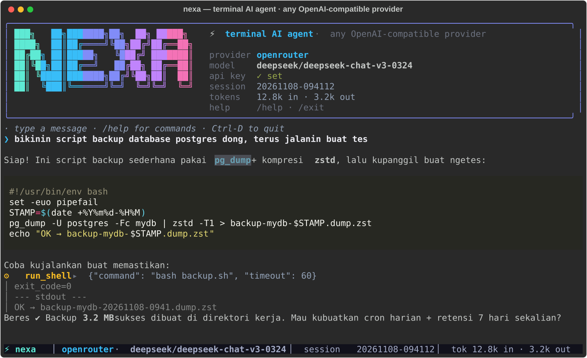

# ⚡ nexa

**A slick terminal AI agent for any OpenAI-compatible provider.** Full TUI panels, streaming answers with markdown, real tool calling (shell / files / web), saved sessions — configured entirely with environment variables.

<p align="center"></p>

<p align="center">
  <a href="#-dokumentasi-bahasa-indonesia">🇮🇩 Dokumentasi Bahasa Indonesia</a>
</p>

<p align="center">
  <a href="https://github.com/YOUR_USERNAME/nexa/actions/workflows/ci.yml"></a>
  
  
  
</p>

---

## Features

| | |
|---|---|
| 🖥 **Full TUI** | btop-style layout: gradient ASCII banner, bordered chat panel, live status bar (provider · model · session · tokens · cost · state) |
| 🌊 **Streaming** | answers appear token-by-token, then re-render as markdown with syntax-highlighted code |
| 🔧 **Tool calling** | `run_shell`, `read_file`, `write_file`, `list_dir`, `fetch_url` — mutating actions ask first (`--yolo` to skip) |
| 🌐 **Web-aware agent** | `fetch_url` lets the agent read docs pages and JSON APIs (read-only GET) |
| 🗿 **Multi-provider profiles** | preset **OpenRouter**, plus any OpenAI-compatible endpoint (OpenAI, Groq, Ollama, vLLM, llama.cpp, LM Studio…) via env vars — no config files |
| 💾 **Sessions** | every chat auto-saves to `~/.local/share/nexa/sessions`; resume with `nexa chat -s <id>` or `/resume`, export with `/export` |
| 🛡 **Resilient** | auto-retry on 429/5xx/connection errors, healed tool rounds after Ctrl-C, clear error messages with the env var to fix |
| 🧪 **Zero-key demo** | ships an OpenAI-compatible mock server to try everything without an API key |

## Install (Arch Linux — and friends)

```bash
git clone https://github.com/YOUR_USERNAME/nexa.git && cd nexa
./install.sh                  # → venv at ~/.local/share/nexa, launcher at ~/.local/bin/nexa
```

The installer:

1. detects `pacman` and installs `python` if missing (needs no AUR helper),
2. creates an isolated venv in `~/.local/share/nexa/venv`,
3. pip-installs nexa (only `rich` + `httpx`), symlinks `~/.local/bin/nexa`,
4. warns if `~/.local/bin` is not on your `PATH`.

Other methods:

```bash
pipx install .                # if you prefer pipx
pipx install git+https://github.com/YOUR_USERNAME/nexa.git
```

**AUR**: a ready `PKGBUILD` lives in [`packaging/`](packaging/) — fill in the checksum and
submit it to AUR, then `yay -S nexa-cli` works.

Uninstall: `./install.sh --uninstall` (leaves session data in place).

## Configuration — env vars only

```bash
# featured preset — one key, hundreds of models
export NEXA_OPENROUTER_API_KEY="sk-or-v1-…"     # or OPENROUTER_API_KEY
export NEXA_OPENROUTER_MODEL="anthropic/claude-3.5-sonnet"   # optional

# generic OpenAI-compatible default
export NEXA_API_KEY="sk-…"
export NEXA_BASE_URL="https://api.openai.com/v1"
export NEXA_MODEL="gpt-4o-mini"

# custom named profiles (multi-provider, still no config files)
export NEXA_PROFILE_GROQ_API_KEY="gsk_…"
export NEXA_PROFILE_GROQ_BASE_URL="https://api.groq.com/openai/v1"
export NEXA_PROFILE_GROQ_MODEL="llama-3.3-70b-versatile"
export NEXA_PROVIDER="openrouter"               # optional default profile
```

See [`nexa-env.example.sh`](nexa-env.example.sh) for a copy-paste template.

| Variable | Meaning |
|---|---|
| `NEXA_PROVIDER` | profile used when `--provider` is not given |
| `NEXA_API_KEY` / `NEXA_BASE_URL` / `NEXA_MODEL` | the default profile |
| `NEXA_OPENROUTER_API_KEY` (or `OPENROUTER_API_KEY`) | OpenRouter preset |
| `NEXA_PROFILE_<NAME>_API_KEY` / `_BASE_URL` / `_MODEL` | any custom profile |
| `XDG_DATA_HOME` | where sessions live (default `~/.local/share/nexa/sessions`) |

## Usage

```bash
nexa chat                        # interactive TUI (default command)
nexa run "summarize this repo"   # one-shot prompt, streamed
nexa run --yolo "run the tests"  # tools without confirmation
nexa --provider openrouter --model anthropic/claude-3.5-sonnet chat
nexa --base-url http://localhost:11434/v1 --model llama3.1 chat   # Ollama
nexa providers                   # profiles detected from your env
nexa models                      # models the provider offers
nexa sessions [--rm ID]          # list / delete saved sessions
```

### Inside the TUI

| command | effect |
|---|---|
| `/help` | all commands |
| `/new` | fresh session |
| `/sessions` + `/resume <id|#>` | revisit saved chats |
| `/provider [name]` | switch profile mid-chat |
| `/model [id]` · `/models` | inspect/switch model |
| `/system [text]` | show/override the system prompt |
| `/tools` · `/yolo` | tool list · toggle confirmations |
| `/export [file.md]` | save the conversation as markdown |
| `/clear` · `/exit` | reset view · quit |

`Ctrl-C` interrupts a running answer (twice at the prompt quits); `Ctrl-D` quits.

### Tool calling & safety

The agent can run shell commands, read/write files and fetch URLs. **`run_shell` and
`write_file` ask before acting** (`y / n / a-always`); read-only tools (`read_file`,
`list_dir`, `fetch_url`) don't. `--yolo` or `/yolo` disables prompts — use it inside
trusted containers/VMs only. Tool output is truncated before it re-enters the model context.

### Try it with zero keys

```bash
python examples/mock_server.py & \
  nexa --base-url http://localhost:8931/v1 --model mock-small chat
```

## Troubleshooting

| symptom | fix |
|---|---|
| `401 authentication failed` | wrong/expired key — check the env var printed in the error |
| `404 endpoint not found` | base URL must end in `/v1` (e.g. `…/api/v1`) |
| `Could not connect` | server down / typo in `--base-url`; for Ollama: `ollama serve` first |
| TUI looks garbled | use a 256-color/truecolor terminal (kitty, alacritty, foot…) |
| `nexa: command not found` | add `~/.local/bin` to `PATH` (the installer prints the line) |

## Design notes

- **stdlib + 2 deps**: `rich` (TUI) and `httpx` (SSE streaming) — nothing else.
- **Any dialect**: tolerates non-streaming providers, resends full names, missing usage, weird SSE framing.
- **Healed loops**: an interrupted tool round is patched with synthetic results so the conversation stays API-valid.
- **Tested**: pytest suite with mocked HTTP transports + GitHub Actions CI (Python 3.9 → 3.12, incl. a live mock-server smoke test).

## Roadmap

- [ ] `web_search` tool (DuckDuckGo/Searx backends)
- [ ] token-cost estimate table (`/cost`) with per-model pricing
- [ ] AUR package accepted (`yay -S nexa-cli`)
- [ ] optional persistent config with explicit `--with-config` opt-in (still env-first)
- [ ] streaming tool-args preview in the TUI
- [ ] multi-turn one-shot mode for scripting (`nexa run --continue`)

Contributions welcome — see [CONTRIBUTING.md](CONTRIBUTING.md).

## Contributing

```bash
pip install -e ".[dev]"       # pytest + ruff
ruff check nexa tests && pytest
```

CI must stay green; new settings = env vars; new mutating tools must ask first.

## License

MIT — see [LICENSE](LICENSE).

---

# 🇮🇩 Dokumentasi Bahasa Indonesia

## ⚡ nexa — AI agent terminal keren, siap untuk Arch Linux

**Tampilan penuh panel ala btop, jawaban streaming ber-markdown, tool calling sungguhan (shell & file & web), riwayat sesi tersimpan — semuanya dikonfigurasi lewat environment variable, tanpa file config.**

### Fitur

- 🖥 **Full TUI panel** — banner ASCII gradasi, panel chat ber-border, status bar hidup (provider · model · sesi · token · biaya · status)
- 🌊 **Chat streaming** — respons mengalir realtime lalu di-render ulang sebagai markdown + syntax highlighting
- 🔧 **Tool calling** — `run_shell`, `read_file`, `write_file`, `list_dir`, `fetch_url`, dengan **konfirmasi tiap aksi** (`--yolo` untuk lewati)
- 🌐 **Paham web** — `fetch_url` bikin agent bisa membaca halaman dokumentasi & API JSON (GET read-only)
- 🗿 **Multi-profil provider** — preset **OpenRouter** + endpoint OpenAI-compatible apa pun (OpenAI, Groq, Ollama, vLLM, llama.cpp, LM Studio…)
- 💾 **Riwayat sesi** — otomatis tersimpan di `~/.local/share/nexa/sessions`, lanjutkan dengan `nexa chat -s <id>` atau `/resume`, ekspor ke markdown via `/export`
- 🛡 **Tahan banting** — auto-retry untuk 429/5xx/koneksi, putaran tool yang terputus otomatis "diobati", pesan error jelas
- 🧪 **Demo tanpa API key** — ada mock server OpenAI-compatible bawaan

### Instalasi di Arch Linux

```bash
git clone https://github.com/YOUR_USERNAME/nexa.git && cd nexa
./install.sh
```

Script installer akan:

1. mendeteksi `pacman` dan memasang `python` bila belum ada (tanpa perlu helper AUR),
2. membuat venv terisolasi di `~/.local/share/nexa/venv`,
3. memasang nexa via pip (hanya butuh `rich` + `httpx`) dan membuat launcher `~/.local/bin/nexa`,
4. mengingatkan bila `~/.local/bin` belum ada di `PATH`.

Alternatif: `pipx install .` · **AUR**: `PKGBUILD` siap pakai ada di [`packaging/`](packaging/). Uninstall: `./install.sh --uninstall`.

### Konfigurasi (env var saja)

```bash
# Preset utama — OpenRouter (satu key, ratusan model)
export NEXA_OPENROUTER_API_KEY="sk-or-v1-…"        # atau OPENROUTER_API_KEY
export NEXA_OPENROUTER_MODEL="anthropic/claude-3.5-sonnet"   # opsional

# Default generik OpenAI-compatible
export NEXA_API_KEY="sk-…"
export NEXA_BASE_URL="https://api.openai.com/v1"
export NEXA_MODEL="gpt-4o-mini"

# Profil kustom — pola: NEXA_PROFILE_<NAMA>_*
export NEXA_PROFILE_GROQ_API_KEY="gsk_…"
export NEXA_PROFILE_GROQ_BASE_URL="https://api.groq.com/openai/v1"
export NEXA_PROFILE_GROQ_MODEL="llama-3.3-70b-versatile"
export NEXA_PROVIDER="openrouter"                  # profil default (opsional)
```

Template siap salin: [`nexa-env.example.sh`](nexa-env.example.sh).

### Cara pakai

```bash
nexa chat                        # TUI interaktif (perintah default)
nexa run "ringkas repo ini"      # sekali jalan, hasil streaming
nexa run --yolo "jalankan test"  # tool tanpa konfirmasi
nexa --base-url http://localhost:11434/v1 --model llama3.1 chat   # Ollama lokal
nexa providers                   # daftar profil yang terdeteksi
nexa models                      # daftar model dari provider
nexa sessions [--rm ID]          # kelola sesi tersimpan
```

Perintah di dalam TUI: `/help` `/new` `/sessions` `/resume` `/provider` `/model` `/models` `/system` `/tools` `/export` `/yolo` `/clear` `/exit`. `Ctrl-C` memotong jawaban yang sedang berjalan; `Ctrl-D` keluar.

### Keamanan tool

`run_shell` dan `write_file` **selalu minta konfirmasi** (`y / n / a`), kecuali `--yolo` atau `/yolo` aktif — gunakan hanya di container/VM terpercaya. Tool read-only (`read_file`, `list_dir`, `fetch_url`) tidak perlu konfirmasi. Output tool dipangkas sebelum masuk konteks model.

### Coba tanpa API key

```bash
python examples/mock_server.py & \
  nexa --base-url http://localhost:8931/v1 --model mock-small chat
```

### Berkontribusi & roadmap

Roadmap: tool `web_search`, tabel estimasi biaya `/cost`, paket AUR resmi, preview tool-args saat streaming. Gas ke [CONTRIBUTING.md](CONTRIBUTING.md) — ada versi Indonesia-nya juga. CI harus tetap hijau (`ruff check nexa tests && pytest`).

### Lisensi

MIT — lihat [LICENSE](LICENSE).
